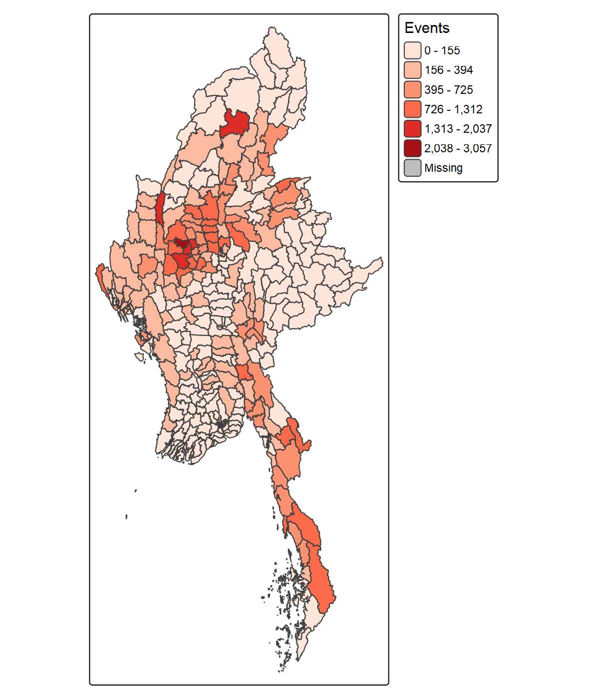
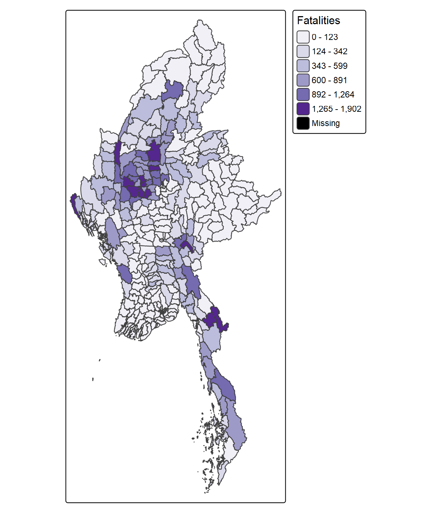
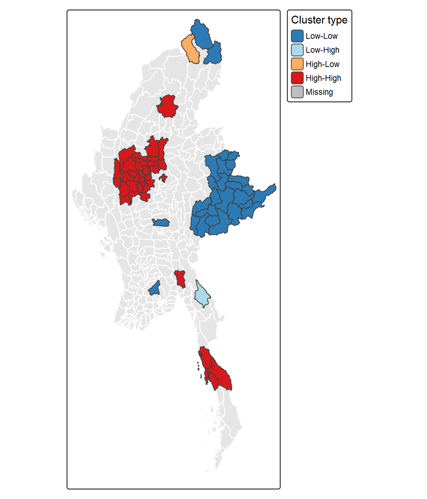
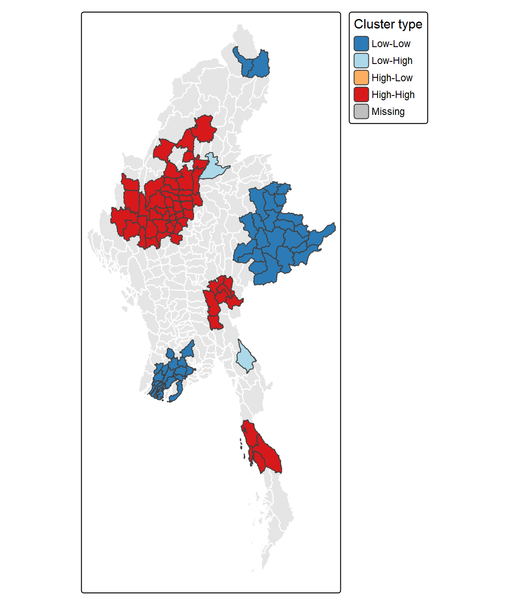
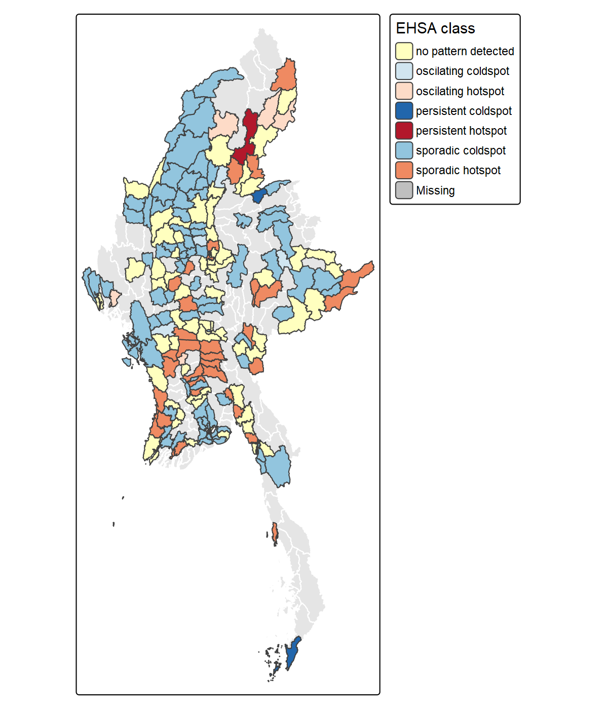
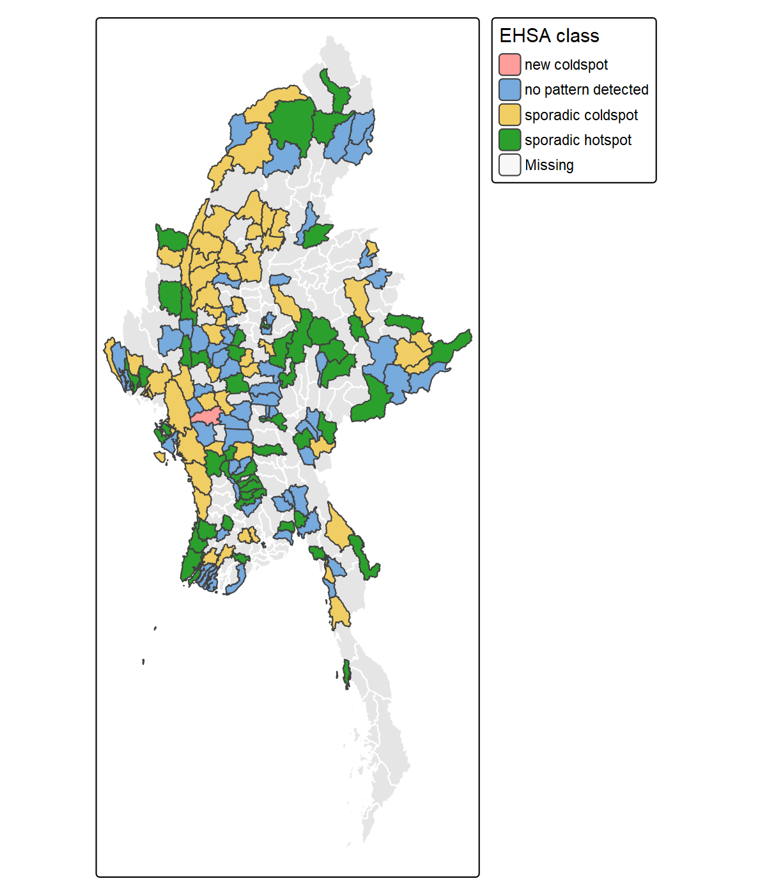
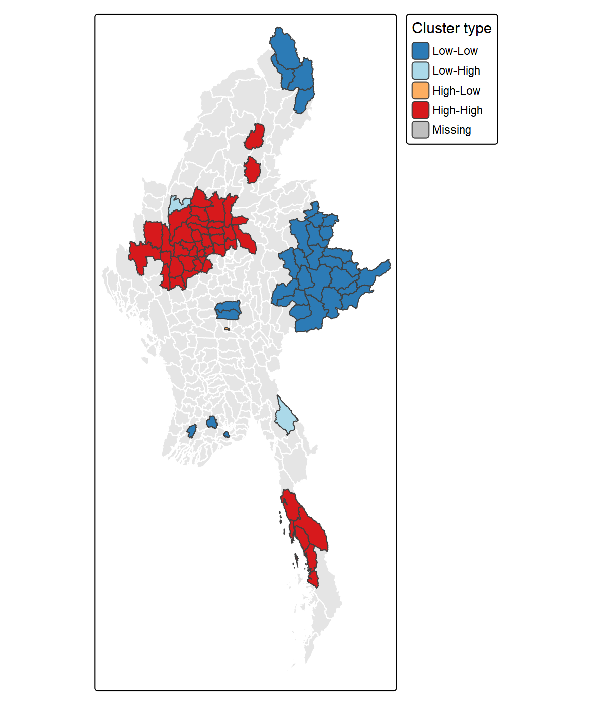

## Research Question

Where is armed conflict in Myanmar concentrated at township level, where do neighbouring townships form statistically significant clusters, and how are hot and cold spots changing over time (January 2021 to September 2025)?

## Study Area, Data and Preparation {.smaller}

- **Study area:** Myanmar, 330 townships (MIMU Township Boundaries v9.4, admin level 3)
- **Conflict data:** ACLED, 87,109 events from 1 Jan 2021 to 30 Sep 2025
- 0 missing coordinates and 0 duplicate event IDs; 384 events (about 0.4%) have approximate locations and were kept
- Events were assigned to townships by spatial join (UTM 47N), and townships with no events were kept as 0
- Space-time cube: 330 townships x 57 months = 18,810 township-months

## Analytical Approach {.smaller}

- **Local Moran's I (LMSA):** queen contiguity, row-standardised weights, log(count + 1), 99 simulations, shown only where p \< 0.05
- **Emerging Hot Spot Analysis (EHSA):** Gi\* for every township-month, then a Mann-Kendall trend test, shown only where the trend p \< 0.05
- Both run on **events** and on **fatalities**
- **Value-added:** LMSA repeated with 6 nearest neighbours, to test whether the result depends on how neighbours are defined

## Where Conflict Happens {.smaller}

::::: columns
::: {.column width="50%"}

:::

::: {.column width="50%"}

:::
:::::

- Conflict is very uneven: events range from 0 to 3,057 per township, fatalities up to 1,902
- Higher event counts sit mainly in the central-west, one township in the far north, and a band down the south-east coast
- Fatalities are concentrated in fewer townships
- Counts are not adjusted for township size or population

## Significant Clusters (Local Moran's I) {.smaller}

::::: columns
::: {.column width="50%"}

:::

::: {.column width="50%"}

:::
:::::

- **Events:** a large High-High cluster in the central-west, smaller ones in the north-centre and the south; a large Low-Low block in the east-centre
- **Fatalities:** a similar layout, with a large High-High cluster in the central-west, smaller High-High clusters in the centre and the far south, and a large Low-Low block in the east-centre
- Two Low-High townships appear on the fatalities map; no High-Low outliers are visible
- Grey townships show no significant pattern, or were excluded because they have no neighbours

## Hot and Cold Spots Over Time (EHSA) {.smaller}

::::: columns
::: {.column width="50%"}

:::

::: {.column width="50%"}

:::
:::::

- **Events, all 330 townships:** 154 sporadic cold spots, 57 sporadic hot spots, 99 with no pattern, 9 persistent cold spots, 6 oscillating hot spots, 4 oscillating cold spots and 1 persistent hot spot (far north)
- **Fatalities:** only sporadic hot spots, sporadic cold spots, "no pattern detected" and one new cold spot appear; no persistent or oscillating spots
- Sporadic cold spots cluster in the north-west and along the west coast; sporadic hot spots are scattered
- Most hot spots come and go rather than staying fixed
- The maps show only townships with a Mann-Kendall trend p \< 0.05

## Value-Added: Does the Result Depend on the Weights? {.smaller}

::::: columns
::: {.column width="50%"}

:::

::: {.column width="50%"}
- Local Moran's I repeated using the 6 nearest neighbours of each township
- Every township now has neighbours, so none are excluded
- Significant townships: 44 High-High, 32 Low-Low, 2 Low-High, 1 High-Low
:::
:::::

## Limitations {.smaller}

- ACLED records reported events, so hard-to-reach areas may be under-recorded and low-count areas are not necessarily peaceful
- Counts are not adjusted for township size or population, and results depend on township boundaries
- Townships with no neighbours were excluded from Local Moran's I, and the EHSA step warned of 4 disconnected groups of townships
- Fatalities are estimates, and 384 events have approximate locations
- Many local tests are run at once, so some significant townships may be false alarms; 99 simulations give coarse p-values

## Peace-Building Implications {.smaller}

- Conflict is concentrated, not uniform: the High-High clusters, especially in the central-west, are candidates for prioritising humanitarian access, monitoring and protection work
- Most hot spots are sporadic, so priorities should be reviewed regularly rather than set once
- Low-Low areas should not be read as safe until reporting coverage is checked
- The results show where and when events were recorded, not why; causes and the people at risk need local data
