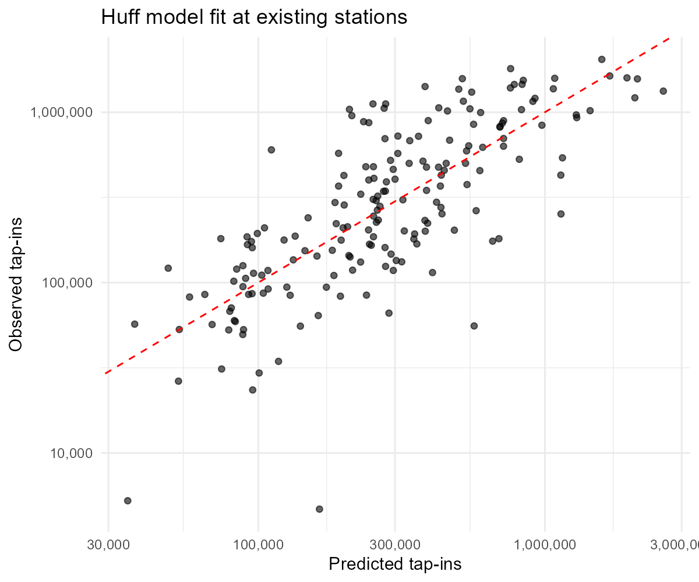
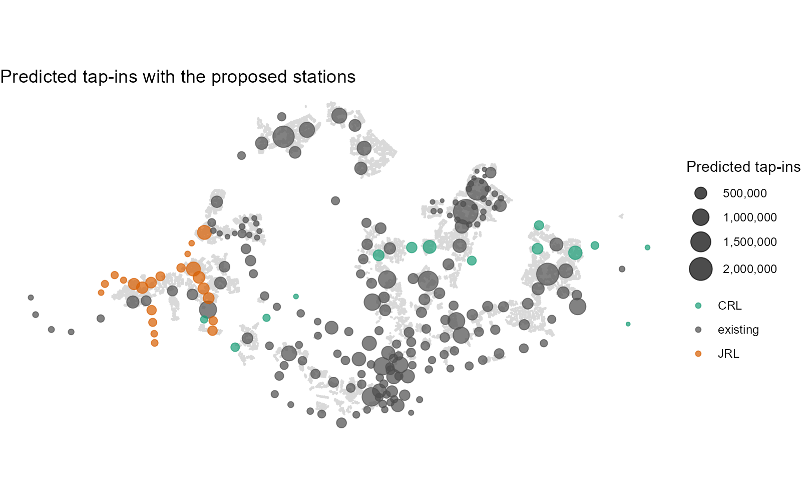
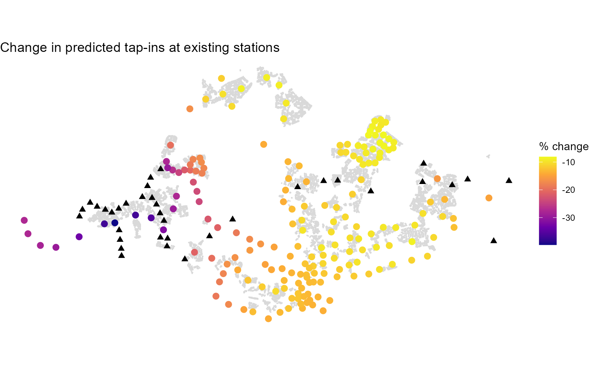
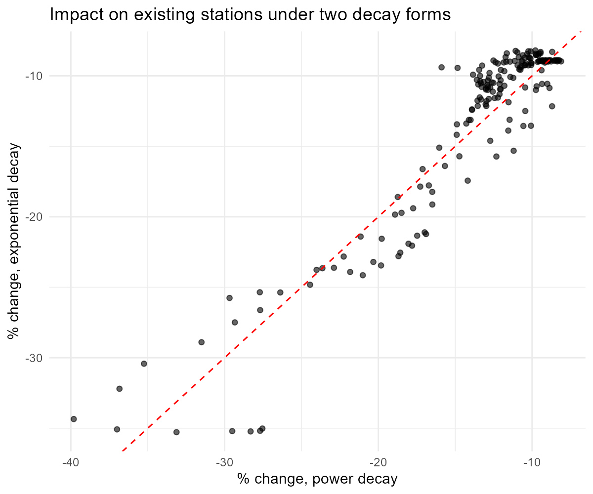

## Research Question

How many passengers would the proposed Jurong Region Line and Cross Island Line stations attract, and how would they change ridership at the existing MRT and LRT stations?

- Calibrate a probabilistic spatial interaction model of station-level ridership
- Predict ridership at existing and proposed stations
- Measure the impact of the proposed stations on existing stations

## Study Area and Data {.smaller}

- **Study area:** the MRT and LRT network of Singapore, with 184 existing stations and 36 proposed Jurong Region Line and Cross Island Line stations
- **Ridership:** LTA DataMall passenger volume by origin and destination train station, September 2026
- **Stations:** Singapore Train Station Coordinates (GitHub), which lists existing and future stations
- **Origins:** HDB Existing Building (data.gov.sg)
- **Attraction variables:** LTA Bus Stop Location (September 2026)

## Data Preparation {.smaller}

- Observed ridership is the total tap-ins at each station in September 2026, summed over all day types and hours
- Ridership was matched to stations by station code, and every code in the ridership data found a station
- Stations in the station list with no ridership are the proposed stations; 11 of them are on other future lines, so they were left out
- All layers were projected to the Singapore CRS (EPSG:3414), so distances are in metres
- Each HDB building is an origin placed at its centroid; its footprint area is the local market potential, because the HDB data has no population column
- Straight-line distances under 100 m were set to 100 m

## Analytical Approach {.smaller}

- **Huff model:** each origin splits its demand between all stations according to station attractiveness and distance decay
- **Attractiveness:** bus stops within 500 m, HDB area within 800 m, and number of lines at the station, plus a separate factor for LRT stations
- **Calibration:** parameters were fitted to the observed tap-ins at existing stations by minimising squared error on the log scale
- The fitted model, with the same constants, then predicts both scenarios: existing stations only, and existing plus proposed
- Total demand is fixed, so a new station can only take ridership from others

## Model Fit {.smaller}

::::: columns
::: {.column width="50%"}

:::

::: {.column width="50%"}
- Distance decay beta is 1.32; the LRT factor is strongly negative, so LRT stations attract far less than MRT stations in the same surroundings
- R2 is 0.58 on the log scale and 0.49 on the raw scale
- Keppel, Riviera and Teck Lee are overpredicted
- Changi Airport, Tanjong Pagar, Somerset and Novena are underpredicted, likely because the model has housing demand only and no jobs or commercial demand
:::
:::::

## Predicted Ridership {.smaller}

::::: columns
::: {.column width="55%"}

:::

::: {.column width="45%"}
- The proposed stations take about 14% of all predicted demand
- Highest predicted monthly tap-ins: Tengah Plantation (about 700,000), Choa Chu Kang West (about 697,000), Pasir Ris East (about 638,000), Serangoon North (about 590,000) and Tengah Park (about 484,000)
- Predictions come from housing demand and distance only, so they are best read as relative sizes
:::
:::::

## Impact on Existing Stations {.smaller}

::::: columns
::: {.column width="55%"}

:::

::: {.column width="45%"}
- Every existing station loses some predicted ridership, because demand is fixed
- The largest losses are in the Jurong area: Boon Lay (about 40%), Pioneer (37%), Lakeside (37%), Chinese Garden (35%), Joo Koon (33%) and Jurong East (32%)
- Stations further east lose less
- Trips that only exist because of the new lines (induced demand) are not modelled
:::
:::::

## Value-Added Analysis {.smaller}

::::: columns
::: {.column width="50%"}

:::

::: {.column width="50%"}
- **Question:** does the impact result depend on the form of the distance decay?
- The model was refitted with exponential decay instead of power decay
- Fit is similar: log-scale R2 of 0.55 against 0.58
- The impact on existing stations is almost identical (correlation 0.94), and so are the predictions at new stations (correlation 0.95)
- Exponential model losses range from 8% to 35%
:::
:::::

## Limitations {.smaller}

- One month of ridership (September 2026); other months may differ
- Local market potential is HDB building footprint area; private housing, workplaces and shops are missing
- Calibration uses station totals only, since the ridership data has no flows from each building
- Distances are straight-line, not walking or transfer distances
- R2 is 0.58, so predictions for individual stations can be well off
- The model fixes total demand, so it cannot show new riders attracted by the new lines

## Planning Implications {.smaller}

- The Jurong area stations would lose the most predicted ridership once the Jurong Region Line opens, so capacity there is worth checking against the new line's timetable
- Tengah Plantation and Choa Chu Kang West have the highest predicted ridership among new stations, so they are candidates for early capacity planning
- Results show relative changes between stations, not forecasts of passenger numbers
- A model with jobs and commercial demand is needed before using the predictions for individual stations
